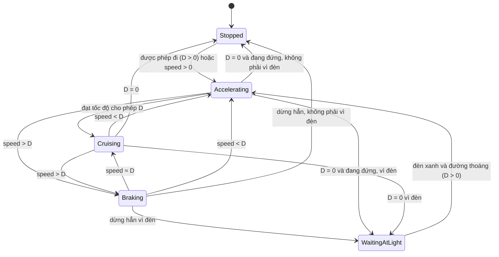

# State Pattern trong simulator

Dự án dùng State Pattern **hai lần**, cho hai vấn đề khác nhau:

| Context | State (giao diện) | Các state cụ thể | Chuyển state do |
|---|---|---|---|
| `TrafficLight` | `TrafficLightState` | `RedState`, `GreenState`, `YellowState` | **thời gian** (hết giờ thì sang màu kế) |
| `Vehicle` | `VehicleState` | `Stopped`, `Accelerating`, `Cruising`, `Braking`, `WaitingAtLight` | **điều kiện giao thông** (tốc độ cho phép, xe trước, đèn) |

## 1. Vấn đề State Pattern giải quyết

Ở Phase 3 đèn giao thông được viết **không** dùng pattern, để thấy vấn đề: mọi hàm phụ thuộc màu đều phải có `switch (màu)`: hàm đổi màu, hàm lấy thời lượng, hàm lấy tên... Thêm một màu mới (ví dụ vàng nhấp nháy) nghĩa là sửa **tất cả** các `switch` đó và dễ sót một chỗ.

Với State Pattern, hành vi riêng của từng màu nằm trong **một lớp riêng**, và `TrafficLight` chỉ giữ state hiện tại rồi uỷ quyền. Thêm màu mới = thêm một lớp, không sửa các lớp cũ (ngoài state đứng trước nó trỏ tới nó).

Xe có vấn đề tương tự nhưng nặng hơn: cùng một lệnh `accelerate()` hay một tick `update()` có ý nghĩa khác nhau tuỳ xe đang đứng, đang tăng tốc, đang phanh hay đang chờ đèn. Một hàm `update` có `if/else` cho 5 trường hợp sẽ rất khó đọc và khó kiểm thử từng trường hợp.

## 2. TrafficLight → TrafficLightState

```
 TrafficLight (context)           TrafficLightState (giao diện)
 ├─ id                            ├─ config, timer           (dùng chung)
 └─ unique_ptr<State> state ────► ├─ update(dt), isFinished(), getTimeRemaining()   (dùng chung, không ảo)
                                  ├─ virtual getName()
                                  ├─ virtual getColor()      -> LightColor
                                  └─ virtual nextState()     -> unique_ptr<TrafficLightState>
                                          ▲          ▲          ▲
                                     RedState   GreenState  YellowState
```

Chuỗi chuyển: `RedState → GreenState → YellowState → RedState`. Mỗi state **tự biết** state kế tiếp (`nextState()` trả về state mới đã đầy thời lượng), nên không có `switch` nào trong `TrafficLight` quyết định "đang đỏ thì đi đâu".

**`TrafficLightConfig`** (3 thời lượng) được sao chép vào mỗi state. Nhờ vậy `RedState::nextState()` tạo được `GreenState(config)` với đúng thời lượng xanh, mà `TrafficLight` không phải biết màu nào dài bao lâu.

**`TrafficLight::update(dt)`:**

```cpp
if (!(dt > 0) || !isfinite(dt)) return;      // dt <= 0, NaN, vô cực: bỏ qua
state->update(dt);                           // trừ timer của state hiện tại
while (state->isFinished()) {                // while, không phải if
    double overshoot = -state->getTimeRemaining();   // thời gian dư >= 0
    state = state->nextState();
    state->update(overshoot);                // mang phần dư sang state mới
}
```

Hai điểm cần hiểu:
- **`while`, không phải `if`:** một `dt` lớn có thể đi qua nhiều màu trong một lần gọi (ví dụ `dt = 5.5` với đỏ 3, xanh 2, vàng 1 kết thúc ở vàng còn 0.5 giây).
- **Mang thời gian dư:** khi `dt` làm timer âm, phần âm là thời gian đã "lấn" sang màu sau. Không mang theo thì đèn sẽ chậm dần theo từng lần đổi màu. Vì vậy chạy 100 bước 0.25 giây cho kết quả giống một lần `update(25)`.
- `isFinished()` là `timer <= 0`: hết **đúng lúc** thì đổi màu ngay.

**Chỗ còn `switch`:** `LightMapper` có một `switch` trên `LightColor`. Đó là phép **dịch** một enum sang enum khác (đèn → tín hiệu xe hiểu), không phải hành vi phụ thuộc state, nên không cần đưa vào state. Dùng `enum class` + `switch` không có `default` còn giúp trình biên dịch cảnh báo nếu thêm màu mà quên ánh xạ.

### Thêm một màu mới (ví dụ `FlashingYellowState`)
1. Tạo `FlashingYellowState` kế thừa `TrafficLightState`: khai báo `getName`, `getColor`, `nextState`.
2. Thêm giá trị vào `LightColor` và (nếu cần) thời lượng vào `TrafficLightConfig`.
3. Sửa `nextState()` của state đứng **trước** nó để trả về state mới.
4. Thêm một `case` trong `LightMapper`.

`TrafficLight` và logic trừ giờ / mang thời gian dư không phải sửa.

## 3. Vehicle → VehicleState

```
 Vehicle (context)                    VehicleState (giao diện)
 ├─ speed, position, fuel ...         ├─ accelerate(vehicle)   lệnh gọi tay
 └─ unique_ptr<VehicleState> ───────► ├─ brake(vehicle)        lệnh gọi tay
                                      ├─ stop(vehicle)         lệnh gọi tay
                                      ├─ update(vehicle, dt)   được gọi mỗi tick
                                      └─ getName()
        Stopped   Accelerating   Cruising   Braking   WaitingAtLight
```

State **không giữ dữ liệu của xe**; nó nhận `Vehicle&` rồi đọc / ghi qua giao diện công khai của `Vehicle`. Vì vậy các state không có trường riêng và rất nhỏ.

### Sơ đồ chuyển state



`D = getDesiredSpeed(dt)` là tốc độ lớn nhất được phép ở tick tới (xem [architecture.md](architecture.md) mục 6). Mọi điều kiện chuyển state đều là so sánh `speed` với `D`, nên các điều kiện **loại trừ nhau** và state không chuyển qua lại vô hạn.

### Mỗi state làm gì ở mỗi tick

| State | `update(vehicle, dt)` |
|---|---|
| `Stopped` | Nếu `speed > 0` hoặc `D > 0` thì sang `Accelerating`; không thì giữ `speed = 0`. Tự chạy lại, không cần ai gọi `accelerate()` |
| `Accelerating` | Nếu `speed > D` thì `Braking`. Nếu `D = 0` và đang đứng thì dừng. Không thì tăng tốc `min(speed + a·dt, D)`; đạt `D` thì sang `Cruising` |
| `Cruising` | `speed > D` → `Braking`; `speed < D` → `Accelerating`; `D = 0` → dừng; còn lại giữ nguyên tốc độ |
| `Braking` | Nếu không cần phanh nữa: `D = 0` → dừng, `speed < D` → `Accelerating`, còn lại `Cruising`. Nếu còn: giảm tốc `max(D, speed − decel·dt)`; về 0 thì dừng |
| `WaitingAtLight` | Nếu `D > 0` (đèn xanh và đường thoáng) thì sang `Accelerating`; không thì giữ `speed = 0` |

"Dừng" nghĩa là gọi `Vehicle::enterHaltState`: vào `WaitingAtLight` nếu xe đang bị **đèn** chặn (`isBlockedByLight`), ngược lại vào `Stopped` (bị xe trước chặn, hết nhiên liệu hoặc `targetSpeed = 0`). Hàm này thay cho đoạn "WaitingAtLight hay Stopped" từng bị lặp 4 lần trong các state.

### Lệnh gọi tay `accelerate()` / `brake()` / `stop()`
Cùng một lệnh, mỗi state phản ứng khác nhau. Đây chính là chỗ State Pattern thay cho `if/else` trên "trạng thái hiện tại":

| Lệnh | `Stopped` | `Accelerating` | `Cruising` | `Braking` | `WaitingAtLight` |
|---|---|---|---|---|---|
| `accelerate()` | sang `Accelerating` nếu được phép đi, không thì in "chưa thể đi" | sang `Cruising` nếu đã đạt tốc độ cho phép | sang `Accelerating` | sang `Accelerating` nếu `D > speed` | sang `Accelerating` nếu `D > 0`, không thì in lý do |
| `brake()` / `stop()` | in "xe đang đứng rồi" | đặt `targetSpeed = 0`, sang `Braking` | như `Accelerating` | in "xe đang phanh" | in "xe đã dừng để chờ đèn" |

Simulation không cần gọi các lệnh này (xe tự quyết định qua `update`); chúng dùng khi điều khiển xe bằng tay hoặc trong test.

### Hai cơ chế hỗ trợ đổi state

- **`Vehicle::transitionTo(newState, dt)`**: đổi state rồi chạy luôn `update` của state mới **trong cùng tick**. Nếu chỉ `setState` thì xe mất trọn một tick chuyển động mỗi lần đổi state (đứng khựng). Có bộ đếm `dispatchDepth` giới hạn 4 lần chuyển liên tiếp mỗi tick để chắc chắn không đệ quy vô hạn.
- **Quy tắc an toàn khi đổi state:** `setState` huỷ object state hiện tại (`unique_ptr` bị gán đè). Vì vậy hàm của state đã gọi `transitionTo` hoặc `setState` **phải `return` ngay** và không được đụng vào thành viên của chính nó. Mọi state trong dự án đều làm vậy; khi viết state mới phải giữ quy tắc này.

## 4. Hai cách dùng State Pattern khác nhau

| | Đèn | Xe |
|---|---|---|
| Ai quyết định chuyển | Chính state (`nextState()`) | Chính state (trong `update`) dựa vào `Vehicle` |
| Chuyển khi nào | Hết thời lượng, luôn theo vòng cố định | Khi điều kiện giao thông đổi, đồ thị chuyển phức tạp |
| State có dữ liệu | Có (`timer`, `config`) | Không (dữ liệu nằm ở `Vehicle`) |
| Số state | 3, cố định vòng | 5, có nhiều đường chuyển |

## 5. Vì sao dùng pattern ở đây, và khi nào thì không

**Phù hợp** vì: (1) hành vi thật sự khác nhau theo state (không chỉ khác tên); (2) có nhiều điều kiện chuyển; (3) cần thêm state mới mà không sợ sửa sót; (4) mỗi state test được riêng (xem `tests/test_trafficlight.cpp`, test 16–18 test từng state).

**Không nên** dùng khi chỉ có hai trạng thái và một cờ `bool`, hoặc khi các state chỉ khác nhau một giá trị số (khi đó dùng một trường dữ liệu là đủ). Roadmap yêu cầu không dùng pattern chỉ để cho đủ nhãn; hai chỗ trên thoả điều kiện này.

## 6. Kiểm thử

- `tests/test_trafficlight.cpp`: thứ tự đổi màu, ranh giới, thời gian dư, `dt` lớn đi qua nhiều màu, từng state riêng, `nextState()`, `LightMapper`, `Lane` đọc đèn sống.
- `tests/test_simulation.cpp` (test 5, 6, 10): xe dừng ở vạch khi đèn đỏ (`WaitingAtLight`), đi qua khi đèn xanh, và khoá lại vị trí / tốc độ / màu đèn ở các bước cố định (hồi quy).
- `tests/test_vehicle.cpp`: nhiên liệu, chạy lại sau khi nạp xăng (qua các chuyển state).
